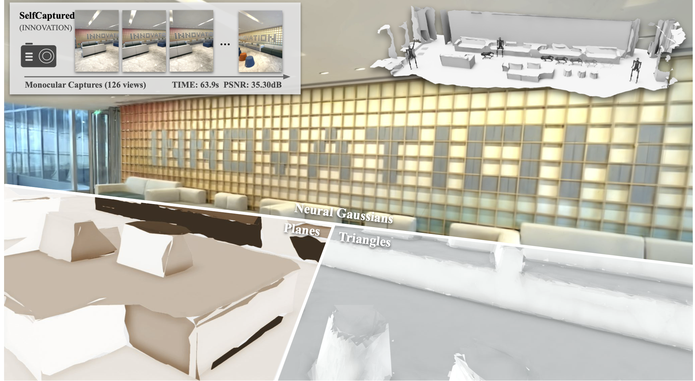
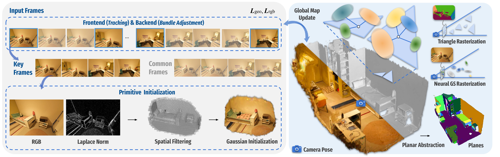

# PLANING: A Loosely Coupled Triangle-Gaussian Framework for Streaming 3D Reconstruction

[](https://city-super.github.io/PLANING/)
[](https://arxiv.org/abs/2601.22046)

[Changjian Jiang*](https://scholar.google.com/citations?hl=en&user=V4miywEAAAAJ), [Kerui Ren*](https://cskrren.github.io/), [Xudong Li](https://orcid.org/0009-0003-8355-2491), [Kaiwen Song](https://orcid.org/0009-0007-1199-5380), [Guanghao Li](https://scholar.google.com/citations?user=6nkKQDIAAAAJ&hl=en), [Linning Xu](https://eveneveno.github.io/lnxu), [Tao Lu](https://scholar.google.com/citations?user=Ch28NiIAAAAJ&hl=en), [Junting Dong](https://scholar.google.com/citations?hl=en&user=dEzL5pAAAAAJ), [Yu Zhang<sup>†</sup>](https://person.zju.edu.cn/zhangyu/), [Yu Feng](https://homepage.zjut.edu.cn/fengyu/), [Bo Dai](https://daibo.info/), [Mulin Yu<sup>†</sup>](https://mulinyu.github.io/)

<sup>* Equal contribution. † Corresponding authors.</sup>

🎉 We are happy to announce that PLANING has been accepted to **NeurIPS 2026**!

## Overview



**PLANING** reconstructs scenes from unposed monocular RGB sequences. Its loosely coupled representation uses explicit triangles for geometry and neural Gaussians for appearance, supporting streaming reconstruction and subsequent refinement.

## Method



The system combines camera tracking, global pose optimization, and incremental mapping. Triangles and Gaussians are initialized from incoming frames and optimized with separate geometry and appearance objectives. The reconstructed triangle soup also supports planar abstraction.

## Installation

The environment follows [ARTDECO](https://github.com/InternRobotics/ARTDECO#installation). Tested with **Python 3.11, PyTorch 2.5.1, CUDA 12.1, GCC 11, and gsplat 1.5.1** on Linux. An NVIDIA GPU must be visible when building the CUDA extensions.

```bash
git clone https://github.com/InternRobotics/PLANING.git
cd PLANING

conda create -n planing python=3.11 -y
conda activate planing
conda install -c nvidia/label/cuda-12.1.1 cuda-toolkit -y

export CUDA_HOME="$CONDA_PREFIX"
export LD_LIBRARY_PATH="$CONDA_PREFIX/lib:$CONDA_PREFIX/lib/python3.11/site-packages/torch/lib:${LD_LIBRARY_PATH:-}"
export MAX_JOBS=4

pip install torch==2.5.1 torchvision==0.20.1 torchaudio==2.5.1 \
    --index-url https://download.pytorch.org/whl/cu121
pip install setuptools==70.0.0 wheel ninja numpy==1.26.4
pip install -r requirements.txt --no-build-isolation
pip install pyaml faiss-cpu natsort
pip install ./third_party/GeoCalib --no-build-isolation
```

Third-party sources are included as ordinary directories; no Git submodule initialization is needed.

- `VSLAM/`: MASt3R-SLAM-based tracking and bundle adjustment, with MASt3R (including DUSt3R, CroCo/curope, and ASMK), Pi3, and Eigen in `VSLAM/thirdparty/`.
- `Reconstruct/`: reconstruction built on ARTDECO, on-the-fly-nvs, and 3DGS, with the Gaussian/triangle rasterizers, simple-knn, and fused-ssim in `Reconstruct/submodules/`.
- `third_party/`: GeoCalib for intrinsic estimation and gsplat for Gaussian rendering.

Installing `requirements.txt` builds and installs gsplat 1.5.1 from the bundled source in `third_party/gsplat/`, matching the version used in our experiments.

Build the remaining bundled extensions from the repository root. MASt3R installation also builds curope and ASMK.

```bash
pip install -e VSLAM/thirdparty/mast3r --no-build-isolation
pip install -e VSLAM --no-build-isolation
pip install Reconstruct/submodules/diff-gaussian-rasterization --no-build-isolation
pip install Reconstruct/submodules/simple-knn --no-build-isolation
pip install Reconstruct/submodules/fused-ssim --no-build-isolation

cd Reconstruct/submodules/diff-triangle-rasterization
pip install . --no-build-isolation
cd ../../..

pip check
```

## Pretrained Models

Download the MASt3R and Pi3 weights following [ARTDECO's model preparation instructions](https://github.com/InternRobotics/ARTDECO#dependency--model-preparation), and place them here:

```text
VSLAM/checkpoints/
├── MASt3R_ViTLarge_BaseDecoder_512_catmlpdpt_metric.pth
├── MASt3R_ViTLarge_BaseDecoder_512_catmlpdpt_metric_retrieval_trainingfree.pth
├── MASt3R_ViTLarge_BaseDecoder_512_catmlpdpt_metric_retrieval_codebook.pkl
└── model.safetensors  # Pi3
```

GeoCalib downloads its [pinhole weights](https://github.com/cvg/GeoCalib/releases/download/v1.0/geocalib-pinhole.tar) on first use. For manual download, save the file as `~/.cache/torch/hub/geocalib/pinhole.tar` without extracting it. LPIPS also downloads its VGG16 backbone on first use. These cache paths use the default Torch Hub location.

## Data Preparation

Arrange each scene as follows:

```text
data/
└── scannet_v2/
    └── scene0000_00/
        ├── images/
        │   ├── 000001.jpg
        │   ├── 000002.jpg
        │   └── ...
        ├── intrinsic/
        │   └── camera.yaml      # Only for known intrinsics
        └── pose_unnormalized/   # Optional ground truth for evaluation
            ├── 000001.txt
            ├── 000002.txt
            └── ...
```

Use RGB images (`.jpg`, `.jpeg`, or `.png`) of the same resolution, with zero-padded filenames in capture order. Camera poses are not required. Without intrinsics, GeoCalib estimates calibration from the first four selected frames; retain at least four frames after sampling.

For known intrinsics, set `camera.yaml` to the input image resolution and calibration. The following values are an example; replace them with your camera's values:

```yaml
width: 640
height: 480
calibration: [525.0, 525.0, 319.5, 239.5]  # fx, fy, cx, cy in pixels
```

Optional ground-truth files contain a 4×4 camera-to-world matrix, with translation in meters, for every input image. Their stems must match the image filenames. Ground truth is used only for trajectory evaluation.

## Quick Start

Edit these settings in the launcher you want to use:

```bash
base_dir="$work_dir/data/scannet_v2"  # Parent directory of the scenes
img_dir="images"              # Image directory inside each scene
default_scenes=("scene0000_00")
gpu=0
```

Run one of the following commands from the repository root:

```bash
# Estimate intrinsics automatically.
bash run_from_self_captured_images.sh

# Read intrinsics from <scene>/intrinsic/camera.yaml.
bash run_with_camera_intrinsics.sh
```

Both launchers use the same algorithm settings:

| Setting | Default |
| --- | --- |
| Input images | `images/`, `downsampling=1.0`, `image_sampling=1` |
| Held-out test views | `--test_hold 8`: every eighth frame after the first frame |
| Initial Gaussians per triangle | 4 or 8; subsequent pruning may reduce the count |
| Model and feature dimensions | `plane_v1`, geometry 16, Gaussian 16 |
| Covariance filtering and accurate loop closure | Enabled |
| Streaming optimization | 20 iterations per keyframe, 10 per common frame |
| Refinement export | 15,000 requested iterations, rounded up to a complete epoch |

The launchers differ only in the source of camera intrinsics and output root: automatic GeoCalib estimation writes to `result/no_intrinsics/`; supplied `intrinsic/camera.yaml` writes to `result/with_intrinsics/`. Both use the same input images and test-view split. Held-out frames are excluded from reconstruction training but still used for pose estimation.

Feature dimensions, triangle loss weights, the opacity threshold, and the two filtering/loop-closure switches use the defaults in `dataloaders/args.py`. Both launchers accept optional Gaussian bounds: `bash <launcher>.sh [num_gs_min] [num_gs_max]` (default: `4 8`).

**Keyframe buffer and RAM.** `run_system.py` sets `SharedKeyframes(..., buffer=1000)`, preallocating CPU shared memory for up to 1,000 SLAM keyframes with the default launchers. Memory usage increases with the buffer size and SLAM image resolution. Adjust `buffer` to fit your available RAM and expected keyframe count. The buffer does not grow automatically or discard old keyframes; exceeding its capacity raises an index error.

## Outputs

Each run writes to `<result_dir>/<scene>/<timestamp>/`:

```text
<timestamp>/
├── metadata.json              # Streaming metrics, timing, and camera information
├── onthefly.ply               # Estimated camera trajectory visualization
├── onthefly.txt               # Estimated camera-to-world poses
├── gt.txt                     # Ground-truth poses; empty when unavailable
└── <refinement_epoch>/
    ├── metadata.json
    ├── onthefly.ply
    ├── onthefly.txt
    ├── gt.txt
    ├── point_clouds/
    │   ├── gs.ply
    │   ├── depth_fusion_mesh.ply
    │   └── triangles.ply
    └── test_images/
        ├── <frame>_gs_rgb.png
        ├── <frame>_gs_depth.png
        └── <frame>_tri_rendered_normal.png
```

Pose text files use `timestamp tx ty tz qx qy qz qw`. `metadata.json` records image metrics when test views exist and ATE when ground truth is available. Its `time` is cumulative streaming and refinement compute time in seconds, excluding exports. Test images are saved only for held-out views; depth PNGs are normalized visualizations. All-frame images, videos, and triangle postprocessing are disabled by default.

## Citation

```bibtex
@article{jiang2026planing,
  title={PLANING: A Loosely Coupled Triangle-Gaussian Framework for Streaming 3D Reconstruction},
  author={Jiang, Changjian and Ren, Kerui and Li, Xudong and Song, Kaiwen and Li, Guanghao and Xu, Linning and Lu, Tao and Dong, Junting and Zhang, Yu and Feng, Yu and Dai, Bo and Yu, Mulin},
  journal={arXiv preprint arXiv:2601.22046},
  year={2026}
}
```

## Acknowledgements

We thank [ARTDECO](https://github.com/InternRobotics/ARTDECO), [MASt3R-SLAM](https://github.com/rmurai0610/MASt3R-SLAM), [MASt3R](https://github.com/naver/mast3r), [Pi3](https://github.com/yyfz/Pi3), [GeoCalib](https://github.com/cvg/GeoCalib), [gsplat](https://github.com/nerfstudio-project/gsplat), [2DGS](https://github.com/hbb1/2d-gaussian-splatting), [convex-splatting](https://github.com/convexsplatting/convex-splatting), [HaloGS](https://city-super.github.io/halogs/), and the authors of the bundled rendering libraries for their open-source work.

## Licenses

Original PLANING code and documentation are licensed under [CC BY-NC-SA 4.0](LICENSE.md), except where otherwise specified. Derived code in [Reconstruct](Reconstruct/LICENSE.md) and [VSLAM](VSLAM/LICENSE.md), and all bundled dependencies, retain their respective licenses and copyright notices in their source directories.
